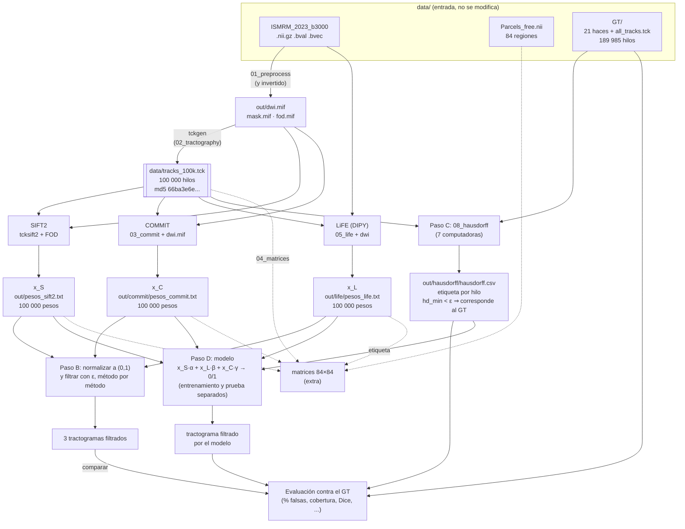
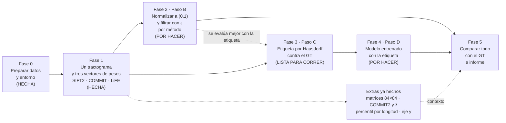

# Diagramas del proyecto

Se ven como dibujo en GitHub y en VS Code (con la extensión de Mermaid). En la terminal se leen como texto.

## 1. Pasos (scripts) y qué hace cada uno

| Script | Qué hace | Parte del objetivo de la junta |
|---|---|---|
| `01_preprocess.sh` | gradientes con `y` invertido, máscara, respuesta y FOD | base |
| `02_tractography.sh` | genera (o usa) `data/tracks_100k.tck`; longitudes; **pesos SIFT2** | paso A |
| `03_commit.sh` | **pesos COMMIT** | paso A |
| `05_life.sh` | **pesos LiFE** (los entregó el equipo de LiFE) | paso A |
| `04_matrices.sh` | matrices 84 × 84 y su evaluación contra el GT | extra |
| `06_commit2.sh` | COMMIT2 (variante) y su matriz | extra |
| `07_normalizacion.sh` | normalización de Ricardo y combinación de métodos | extra / paso B parcial |
| `08_hausdorff.sh` | etiqueta por Hausdorff, por bloques | paso C |
| `09_...` (por hacer) | filtrado individual: normalizar y barrer ε por método | paso B |
| `10_...` (por hacer) | modelo `(x_S, x_L, x_C) → etiqueta` | paso D |

La numeración sigue el **orden en que se fueron agregando**, no el orden del objetivo nuevo. `pipeline.md` documenta los pasos 1, 2, 3, 4, 6 y 8 (faltan por escribir las secciones de los pasos 5 y 7).

## 2. Flujo de datos

Cuadro `[[ ]]` = el archivo central que comparten todos. Líneas punteadas = el trabajo extra (matrices).

## 3. Fases del proyecto

| Fase | Estado | Dónde |
|---|---|---|
| 0. Datos y entorno | hecha | `environment.yml`, `data/README.md` |
| 1. Tractograma y tres vectores de pesos | hecha | pasos 1–3 y 5; archivos en `docs/interno/ACTUALIZACION.md` sección 4 |
| 2. Normalizar y filtrar con ε (paso B) | por hacer (el siguiente script) | `docs/interno/ACTUALIZACION.md` sección 5 |
| 3. Etiqueta por Hausdorff (paso C) | script listo y probado; falta correrlo en 7 computadoras | `docs/hausdorff_instrucciones.md` |
| 4. Modelo entrenado (paso D) | por hacer | `docs/junta_17nov.md` |
| 5. Comparación con el GT e informe | por hacer | — |
| Extras | hechos | `docs/resultados/extras.md` |
